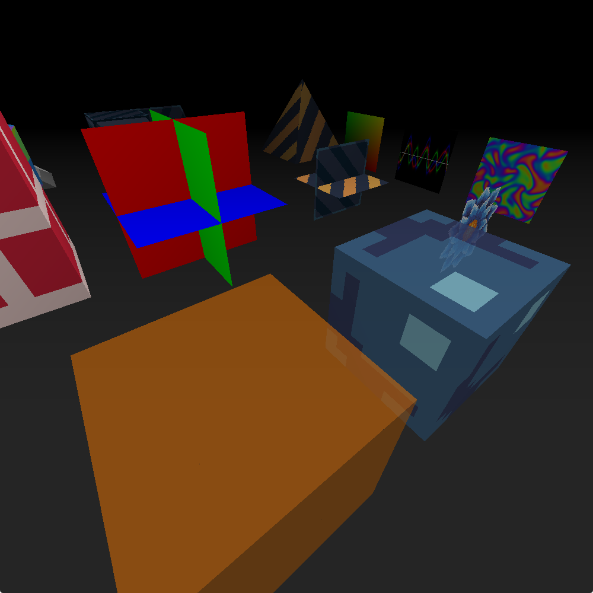

# Ultimate Engine
Ultimate Engine is a 3D CPU-based software rasterizer featuring textures, shaders and transparent geometry. The environment can easily be modified in code ([main.cpp](source/main.cpp)) without requiring visual tools or an editor. Shaders are written using C++.



This project is a rewrite of [Acerx-AMJ/3D-software-rasterizer](https://github.com/Acerx-AMJ/3D-software-rasterizer) with easier geometry creation and rendering and a plethora of new functionality.

## Building
This project depends on C++17 and Raylib. The easiest way to build is using CMake:
```bash
cmake -B build
cmake --build build
```
The executable will be located in `build/ultimate`. The assets and shaders folders must be in the same directory in which the executable is run.

## Credits
This project was made by Daniel Vishnevsky and is licensed under MIT License.
